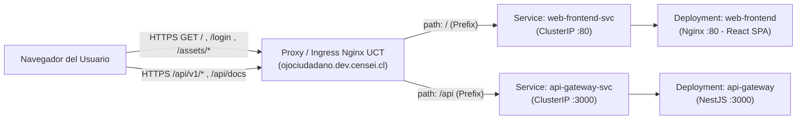

# Estrategia de Despliegue Web en Kubernetes UCT

**Responsable:** Martín Maier  
**Issue:** #128 (MTN-09) — Definir la estrategia de despliegue Web en Kubernetes UCT  
**Proyecto:** Ojo Ciudadano  
**Versión:** 1.0.0 — Sprint 2  

---

## 1. Objetivo y Alcance

Este documento define la arquitectura y estrategia técnica para compilar, empaquetar y desplegar la aplicación **Web (Frontend React + Vite)** en el clúster institucional de **Kubernetes de la Universidad Católica de Temuco (UCT)** (`https://k8s-estudiantes.dev.censei.cl`).

### 1.1 Distinción de Entornos
* **Entorno Remoto Oficial (Staging / Producción Académica):** **Kubernetes UCT** es la plataforma remota definitiva del proyecto para alojar tanto los microservicios backend como la aplicación Web.
* **Entorno de Desarrollo Local:** **Docker Compose** (`web/backend/docker-compose.yml`) y el servidor de desarrollo de Vite (`npm run dev`) se utilizan **exclusivamente para desarrollo y pruebas locales** en las máquinas del equipo. Docker Compose no se utiliza como entorno remoto.

---

## 2. Delimitación de Responsabilidades y Tareas Relacionadas

Para evitar duplicidad de esfuerzos y mantener trazabilidad en el Sprint 2, esta estrategia articula tres tareas complementarias:

| Referencia | Responsable | Alcance y Delimitación |
| :--- | :--- | :--- |
| **Issue #78** | Diego Álvarez | **Infraestructura Backend en Kubernetes UCT** (ya integrada en `integration`). Provee el namespace `student-daalvarez`, ServiceAccount `ci-deployer`, PostgreSQL, Deployments/Services de los 4 servicios backend, ConfigMap `backend-config` e Ingress inicial en `ojociudadano.dev.censei.cl`. |
| **Issue #128 (MTN-09)** | Martín Maier | **Estrategia de Despliegue Web (este documento).** Define la arquitectura del contenedor Nginx, resolución de rutas SPA, diseño de `Deployment`, `Service` e `Ingress`, gestión de `ConfigMaps` vs `Secrets`, comunicación con el API Gateway y procedimiento de despliegue/rollback. |
| **Issue #127** | Martín Maier | **Configuración de Orígenes CORS y URLs por Entorno.** Implementa en código y ConfigMaps la parametrización de `CORS_ORIGINS`, las URLs internas de microservicios y la variable pública `VITE_API_URL` utilizando exactamente los nombres definidos en este documento. |
| **Issue #129 (CRI-07)** | Cristóbal Santibáñez | **Construcción de Imagen y Despliegue Web en Kubernetes UCT.** Implementa el `Dockerfile` multi-stage de `web/frontend`, el archivo `nginx.conf`, los manifiestos de Kubernetes y ejecuta el despliegue verificando su operación basándose directamente en esta especificación. |

---

## 3. Namespace y Ubicación en el Clúster

* **Namespace institucional:** `student-daalvarez`
  * Todos los recursos de la aplicación Web (`Deployment`, `Service`, `ConfigMap` e `Ingress`) se desplegarán dentro del mismo namespace `student-daalvarez` establecido en la **Issue #78**.
* **Ubicación de manifiestos en el repositorio:**
  * Los manifiestos de la Web se versionarán en `infrastructure/k8s/services/web-frontend.yaml` (o integrados junto a los servicios en `infrastructure/k8s/services/`) y su configuración en `infrastructure/k8s/config/`.

---

## 4. Empaquetado y Ejecución del Frontend (Imagen Multi-Stage con Nginx)

La aplicación Web (`web/frontend`) es una Single Page Application (SPA) construida con **React 19, TypeScript y Vite**. En el entorno Kubernetes UCT **no debe ejecutarse mediante el servidor de desarrollo de Vite (`vite dev` / Node.js)**, sino como artefactos estáticos precompilados servidos por **Nginx**.

### 4.1 Arquitectura del `Dockerfile` (`web/frontend/Dockerfile`)
La imagen se construirá en dos etapas (*multi-stage build*):

1. **Etapa 1 — Compilación (`builder`):**
   * Imagen base: `node:20-alpine`.
   * Instala dependencias de forma determinista con `npm ci`.
   * Recibe la variable de construcción `ARG VITE_API_URL` y la expone como `ENV VITE_API_URL=${VITE_API_URL}` antes de compilar.
   * Ejecuta `npm run build` (`tsc -b && vite build`), generando los archivos estáticos optimizados en `/app/dist`.
2. **Etapa 2 — Servidor Web (`runner`):**
   * Imagen base: `nginx:stable-alpine` (ligera y de bajo consumo de memoria/CPU para respetar las cuotas del namespace UCT).
   * Copia los artefactos estáticos desde `/app/dist` hacia `/usr/share/nginx/html`.
   * Copia la configuración personalizada de Nginx (`web/frontend/nginx.conf`) hacia `/etc/nginx/conf.d/default.conf`.
   * Expone el puerto `80` (`containerPort: 80`).

### 4.2 Resolución de Rutas de React (SPA Routing)
Al utilizar `react-router-dom` con rutas del lado del cliente (como `/login`, `/`, etc.), cualquier acceso directo mediante la barra de direcciones o recarga de página (`F5`) solicita esa ruta al servidor HTTP. Si Nginx busca un archivo físico como `/usr/share/nginx/html/login`, devolvería un error `404 Not Found`.

Para resolverlo, la configuración de Nginx (`nginx.conf`) **debe incluir la directiva `try_files` con fallback a `/index.html`**:

```nginx
server {
    listen 80;
    server_name _;

    root /usr/share/nginx/html;
    index index.html;

    # Compresión gzip para activos estáticos
    gzip on;
    gzip_types text/plain text/css application/json application/javascript text/xml application/xml text/javascript;

    # Activos estáticos con caché
    location /assets/ {
        expires 1y;
        add_header Cache-Control "public, immutable";
        try_files $uri =404;
    }

    # Resolución de rutas SPA (React Router): cualquier ruta no estática entrega index.html
    location / {
        try_files $uri $uri/ /index.html;
    }
}
```

### 4.3 Registro de Contenedores y Etiquetado (Tagging)
* **Registro:** GitHub Container Registry (`ghcr.io`), coherente con `#78`.
* **Nombre de la imagen:** `ghcr.io/ojo-ciudadano/ojo_ciudadano_proyecto/web-frontend`
* **Política de etiquetas (Tags):**
  * Cada compilación publicada debe etiquetarse con una versión identificable (SHA corto del commit, ej. `ghcr.io/ojo-ciudadano/ojo_ciudadano_proyecto/web-frontend:<git-sha>` o versión semántica `v2.0.x`) además de actualizar la etiqueta `:latest`. Esto permite trazabilidad exacta y retorno inmediato a una versión previa.

---

## 5. Arquitectura de Recursos en Kubernetes (`Deployment`, `Service`, `Ingress`)



### 5.1 Función del `Deployment` (`web-frontend`)
Gestiona el ciclo de vida, réplicas y actualizaciones graduales de los pods que sirven el frontend:
* **Nombre:** `web-frontend`
* **Etiqueta (`selector` / `labels`):** `app: web-frontend`
* **Estrategia de actualización:** `RollingUpdate` (`maxSurge: 0`, `maxUnavailable: 1`), idéntica a la definida en `backend-workloads.yaml` (#78) para no exceder las cuotas de recursos del namespace durante despliegues.
* **Cuotas de recursos por contenedor (ajustadas al clúster UCT):**
  * `requests`: `cpu: 15m`, `memory: 32Mi`
  * `limits`: `cpu: 100m`, `memory: 128Mi`
* **Probes de salud:** `readinessProbe` y `livenessProbe` mediante `httpGet` a `path: /` en `port: 80`.

### 5.2 Función del `Service` (`web-frontend-svc`)
Expone internamente los pods de `web-frontend` dentro del clúster mediante una IP virtual estable para que el controlador Ingress pueda enrutar tráfico hacia ellos:
* **Nombre:** `web-frontend-svc`
* **Tipo:** `ClusterIP` (sin exposición directa de NodePort ni LoadBalancer).
* **Selector:** `app: web-frontend`
* **Puertos:** `port: 80` $\rightarrow$ `targetPort: 80` (`protocol: TCP`).

### 5.3 Función del `Ingress` y Enrutamiento Unificado por Path
En el clúster institucional UCT, el acceso externo se realiza mediante el controlador `ingressClassName: nginx` asociado al proxy institucional (`external-dns.alpha.kubernetes.io/target: proxy.inf.uct.cl`) bajo el host asignado al proyecto: **`ojociudadano.dev.censei.cl`**.

Para que la aplicación Web y el API Gateway convivan limpiamente bajo el dominio institucional sin requerir subdominios DNS adicionales:

| Host | Path | PathType | Servicio Destino | Puerto | Propósito |
| :--- | :--- | :--- | :--- | :--- | :--- |
| `ojociudadano.dev.censei.cl` | `/api` | `Prefix` | `api-gateway-svc` | `3000` | Enruta todas las llamadas a `/api/v1/*` y `/api/docs` hacia el API Gateway. |
| `ojociudadano.dev.censei.cl` | `/` | `Prefix` | `web-frontend-svc` | `80` | Enruta la raíz, rutas de React (`/login`, etc.) y activos (`/assets/*`) al contenedor Nginx. |

> [!IMPORTANT]
> En Kubernetes Ingress (`networking.k8s.io/v1`), cuando se definen ambos prefijos `/api` y `/` en el mismo host, el controlador Nginx evalúa primero el prefijo más específico (`/api`) hacia `api-gateway-svc:3000` y envía el resto del tráfico (`/`) hacia `web-frontend-svc:80`.

#### Tratamiento de TLS y Datos Institucionales
* **Terminación TLS actual:** El proxy inverso institucional (`proxy.inf.uct.cl`) publica el dominio `https://ojociudadano.dev.censei.cl` proveyendo terminación HTTPS en el borde del clúster y reenviando tráfico al Ingress Controller de Kubernetes.
* **Certificados y Datos Institucionales Pendientes:**
  * Actualmente el certificado presentado por el borde institucional es autofirmado o de CA interna de desarrollo (`dev.censei.cl`).
  * **Dato institucional pendiente (si aplica):** En caso de que los administradores del clúster UCT habiliten `cert-manager` o entreguen un Secret TLS específico para el namespace `student-daalvarez`, se añadirá el bloque `spec.tls` en el manifiesto `Ingress` referenciando dicho `secretName` sin alterar las reglas de host ni paths. No se inventan nombres de `ClusterIssuer` ni secretos TLS no provistos por la UCT.

---

## 6. Comunicación del Navegador con el API Gateway

### 6.1 Prohibición de Direcciones Internas en el Cliente Web
Las llamadas de `axios` en React se ejecutan **en el navegador del usuario final**, fuera de la red interna de Kubernetes. Por lo tanto:
* **Nunca** debe configurarse `VITE_API_URL` con nombres DNS internos del clúster (como `http://api-gateway-svc:3000`), ni con `http://localhost:3000`, `10.0.2.2` o IPs privadas en el despliegue remoto.
* El navegador debe comunicarse **exclusivamente** a través de la URL pública expuesta por el Ingress institucional.

### 6.2 Valor de `VITE_API_URL` por Entorno
Dado que el cliente HTTP (`web/frontend/src/services/api.ts`) construye `baseURL` como `${API_URL}/api/v1`:

| Entorno | Valor de `VITE_API_URL` | `baseURL` resultante en el navegador |
| :--- | :--- | :--- |
| **Desarrollo Local** (`.env`) | `http://localhost:3000` | `http://localhost:3000/api/v1` |
| **Kubernetes UCT** (Remoto) | `https://ojociudadano.dev.censei.cl` | `https://ojociudadano.dev.censei.cl/api/v1` |

---

## 7. Mecanismo de Configuración Pública, `ConfigMaps` y `Secrets`

### 7.1 Incorporación de la Configuración Pública del Frontend
Vite reemplaza las variables con prefijo `VITE_*` (`import.meta.env.VITE_API_URL`) de manera estática **durante la etapa de compilación (`npm run build`)**.

Para mantener trazabilidad declarativa en Kubernetes y compatibilidad con el código existente sin introducir scripts complejos de reescritura en tiempo de arranque:
1. **En Kubernetes (`ConfigMap`):** Se define el ConfigMap `web-frontend-config` en el namespace `student-daalvarez` con el valor canónico de `VITE_API_URL: "https://ojociudadano.dev.censei.cl"`, referenciado también en el `Deployment` (`envFrom`) como registro auditable del entorno activo.
2. **En la Compilación de la Imagen (`Dockerfile`):** El valor de `VITE_API_URL` se pasa mediante `--build-arg VITE_API_URL=https://ojociudadano.dev.censei.cl` durante `docker build`.
3. **Cómo aplicar cambios en `VITE_API_URL`:**
   * Si cambia la URL pública del API Gateway, se actualiza el valor en `web-frontend-config`, se **reconstruye y publica la imagen** pasando el nuevo `--build-arg VITE_API_URL`, y se reinicia el `Deployment` (`kubectl rollout restart deployment/web-frontend`).

### 7.2 Clasificación de `ConfigMaps` vs `Secrets` (Alineado con #78 y #127)

| Recurso K8s | Tipo | Claves / Variables | Propósito |
| :--- | :--- | :--- | :--- |
| `web-frontend-config` | `ConfigMap` | `VITE_API_URL: "https://ojociudadano.dev.censei.cl"` | Configuración pública no sensible de la Web. |
| `backend-config` | `ConfigMap` | `CORS_ORIGINS: "https://ojociudadano.dev.censei.cl,http://localhost:5173"`<br>`PUBLIC_API_URL: "https://ojociudadano.dev.censei.cl"`<br>`AUTH_SERVICE_URL: "http://auth-svc:3001"`<br>`INCIDENTES_SERVICE_URL: "http://incidentes-svc:3002"`<br>`NOTIFICACIONES_SERVICE_URL: "http://notificaciones-svc:3003"`<br>`DB_HOST_*`, `DB_PORT_*`, `DB_NAME_*` | Direcciones internas de servicios, orígenes CORS permitidos (#127) y parámetros no sensibles de BD (#78). |
| `backend-secrets` | `Secret` (`Opaque`) | `postgres-auth`, `postgres-incidentes`, `postgres-notificaciones`, `jwt-secret` | Credenciales de bases de datos y llave de firma JWT del backend (#78). |
| `ghcr-pull-secret` *(solo si aplica)* | `Secret` (`dockerconfigjson`) | `.dockerconfigjson` | **Opcional:** Solo requerido si algún paquete en GHCR se configura como privado. Actualmente los paquetes de `Ojo-Ciudadano` en GHCR son públicos, por lo que el clúster descarga la imagen sin `imagePullSecrets`. |

> [!CAUTION]
> **Regla Estricta de Seguridad para el Frontend:**  
> Todo archivo empaquetado en la imagen de `web-frontend` es descargado públicamente por el navegador del usuario. **Ningún secreto** (contraseñas de PostgreSQL, `JWT_SECRET`, tokens de administración de Kubernetes `K8S_TOKEN` ni credenciales de MinIO) debe incorporarse jamás al código fuente del frontend, ni pasarse como `VITE_*`, ni montarse desde `backend-secrets` en el Deployment `web-frontend`.

---

## 8. Procedimiento de Despliegue y Retorno a Versión Anterior (Rollback)

### 8.1 Procedimiento para Desplegar una Nueva Versión
Este es el flujo operativo que ejecutará **#129 (CRI-07)** (manualmente o vía GitHub Actions en `.github/workflows/`):

1. **Construir y etiquetar la imagen Docker (con SHA identificable):**
   ```bash
   GIT_SHA=$(git rev-parse --short HEAD)
   docker build \
     --build-arg VITE_API_URL=https://ojociudadano.dev.censei.cl \
     -t ghcr.io/ojo-ciudadano/ojo_ciudadano_proyecto/web-frontend:${GIT_SHA} \
     -t ghcr.io/ojo-ciudadano/ojo_ciudadano_proyecto/web-frontend:latest \
     ./web/frontend
   ```
2. **Publicar la imagen en GitHub Container Registry (`ghcr.io`):**
   ```bash
   docker push ghcr.io/ojo-ciudadano/ojo_ciudadano_proyecto/web-frontend:${GIT_SHA}
   docker push ghcr.io/ojo-ciudadano/ojo_ciudadano_proyecto/web-frontend:latest
   ```
3. **Aplicar manifiestos y actualizar el Deployment en Kubernetes UCT (`student-daalvarez`):**
   ```bash
   kubectl apply -f infrastructure/k8s/config/ -n student-daalvarez
   kubectl apply -f infrastructure/k8s/services/ -n student-daalvarez
   kubectl set image deployment/web-frontend \
     web-frontend=ghcr.io/ojo-ciudadano/ojo_ciudadano_proyecto/web-frontend:${GIT_SHA} \
     -n student-daalvarez
   kubectl rollout status deployment/web-frontend -n student-daalvarez --timeout=180s
   ```
4. **Verificación post-despliegue:**
   * Comprobar carga de la SPA: `curl -I -k https://ojociudadano.dev.censei.cl/` (`HTTP/2 200`).
   * Comprobar resolución de ruta React directa: `curl -I -k https://ojociudadano.dev.censei.cl/login` (`HTTP/2 200`, entregando `index.html` sin 404).
   * Comprobar API Gateway: `curl -k https://ojociudadano.dev.censei.cl/api/v1` (`Hello World!`).

### 8.2 Procedimiento de Retorno a la Versión Anterior (Rollback)
Si una versión desplegada presenta fallos visuales o de integración, Kubernetes almacena el historial de `ReplicaSets` del Deployment `web-frontend`. Para revertir de inmediato sin necesidad de recompilar:

1. **Consultar el historial de revisiones desplegadas:**
   ```bash
   kubectl rollout history deployment/web-frontend -n student-daalvarez
   ```
2. **Revertir inmediatamente a la versión anterior estable:**
   ```bash
   kubectl rollout undo deployment/web-frontend -n student-daalvarez
   ```
   *(Opcionalmente, para volver a una etiqueta de imagen específica conocida):*
   ```bash
   kubectl set image deployment/web-frontend \
     web-frontend=ghcr.io/ojo-ciudadano/ojo_ciudadano_proyecto/web-frontend:<SHA_ANTERIOR> \
     -n student-daalvarez
   ```
3. **Verificar que el rollback completó con éxito:**
   ```bash
   kubectl rollout status deployment/web-frontend -n student-daalvarez --timeout=180s
   ```
