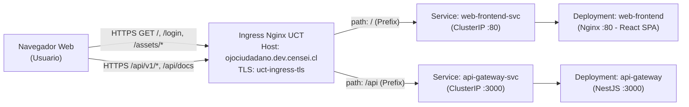

# Estrategia de Despliegue Web en Kubernetes UCT

**Responsable:** Martín Maier  
**Issue:** #128 (MTN-09) — Definir la estrategia de despliegue Web en Kubernetes UCT  
**Proyecto:** Ojo Ciudadano  
**Versión:** 1.0.0 — Sprint 2  

---

## 1. Objetivo y Alcance

Este documento define la arquitectura y estrategia técnica para compilar, empaquetar y desplegar la aplicación **Web (Frontend React + TypeScript + Vite)** en el clúster institucional de **Kubernetes de la Universidad Católica de Temuco (UCT)** (`https://k8s-estudiantes.dev.censei.cl`) y su comunicación con el **API Gateway**.

### 1.1 Distinción de Entornos (Remoto vs. Local)
* **Entorno Remoto Oficial (Sprint 2):** **Kubernetes UCT** es el entorno remoto elegido para alojar tanto los microservicios backend como la aplicación Web de Ojo Ciudadano.
* **Entorno de Desarrollo Local:** **Docker Compose** (`web/backend/docker-compose.yml`) y el servidor de desarrollo de Vite (`npm run dev`) se emplean **exclusivamente como herramientas de desarrollo y pruebas locales**. Docker Compose no se utiliza como entorno remoto.

---

## 2. Delimitación de Tareas y Referencias Cruzadas

La puesta en marcha de la Web en Kubernetes UCT articula tres tareas complementarias con alcances estrictamente delimitados:

| Referencia | Responsable | Alcance y Responsabilidad |
| :--- | :--- | :--- |
| **Issue #78** | Diego Álvarez | **Infraestructura Backend en Kubernetes UCT** (completada e integrada). Provee el namespace `student-daalvarez`, RBAC/ServiceAccount `ci-deployer`, las 3 instancias PostgreSQL con persistencia `cinder-ceph`, Deployments/Services de los 4 servicios NestJS, `backend-config` e Ingress inicial (`ojociudadano.dev.censei.cl`). |
| **Issue #127** | Martín Maier | **Configuración de Orígenes CORS y URLs por Entorno** (completada e integrada). Centraliza `CORS_ORIGINS`, `PUBLIC_API_URL`, `*_SERVICE_URL` y `VITE_API_URL`, incorpora estos valores en `backend-config` (`ConfigMap`) y agrega la anotación `proxy-body-size: "12m"` en el Ingress. |
| **Issue #128 (MTN-09)** | Martín Maier | **Estrategia de Despliegue Web en Kubernetes UCT (este documento).** Define el contenedor Nginx multi-stage, resolución de rutas SPA, diseño de `Deployment`, `Service` e `Ingress` con **enrutamiento Single-Host**, cuotas de hardware, `ConfigMaps` vs. `Secrets`, visibilidad pública en GHCR y procedimiento de despliegue/rollback. |
| **Issue #129 (CRI-07)** | Cristóbal Santibáñez | **Construcción de Imagen y Despliegue Web en Kubernetes UCT.** Crea el `Dockerfile` y `nginx.conf` de `web/frontend`, escribe los manifiestos de Kubernetes de la Web siguiendo esta estrategia, publica la imagen en GHCR (configurándola como **Public**) y ejecuta el despliegue verificando la operación extremo a extremo desde el navegador. |

---

## 3. Namespace e Integración con el Clúster UCT

* **Namespace institucional:** `student-daalvarez`
  * Todos los recursos de la aplicación Web (`Deployment`, `Service`, `ConfigMap` y reglas de `Ingress`) deben residir en el namespace `student-daalvarez`, coherente con la **Issue #78**.
* **Ubicación de manifiestos en el repositorio:**
  * Configuración no sensible: `infrastructure/k8s/config/` (o junto a `backend-config.yaml`).
  * Carga de trabajo y servicio: `infrastructure/k8s/services/web-frontend.yaml` y actualización de rutas en `infrastructure/k8s/services/api-gateway-ingress.yaml`.

---

## 4. Ejecución del Frontend Compilado mediante Imagen con Nginx

La aplicación Web (`web/frontend`) es una Single Page Application (SPA) en React + Vite. En Kubernetes UCT **no debe ejecutarse con `vite dev` ni Node.js en tiempo de ejecución**, sino como activos estáticos precompilados servidos por **Nginx**.

### 4.1 Estructura Multi-Stage del `Dockerfile` (`web/frontend/Dockerfile`)
1. **Etapa 1 — Compilación (`builder`):**
   * Imagen base: `node:20-alpine`.
   * Directorio de trabajo `/app`, copia `package*.json` y ejecuta `npm ci`.
   * Recibe el argumento de compilación `ARG VITE_API_URL=https://ojociudadano.dev.censei.cl` y lo declara como `ENV VITE_API_URL=${VITE_API_URL}`.
   * Ejecuta `npm run build` (`tsc -b && vite build`), generando el bundle estático en `/app/dist`.
2. **Etapa 2 — Servidor HTTP (`runner`):**
   * Imagen base: `nginx:stable-alpine` (imagen liviana que consume ~10–25 MB de RAM en reposo, ideal para las cuotas del namespace UCT).
   * Copia `/app/dist` hacia `/usr/share/nginx/html`.
   * Copia el archivo de configuración `web/frontend/nginx.conf` hacia `/etc/nginx/conf.d/default.conf`.
   * Expone el puerto `80` (`containerPort: 80`).

### 4.2 Resolución de Rutas de React (SPA Fallback en Nginx)
Dado que React Router gestiona rutas en el cliente (ej. `/login`, `/`, `/incidentes`, etc.), cuando un usuario ingresa directamente a `https://ojociudadano.dev.censei.cl/login` o recarga la página (`F5`), el navegador solicita `/login` al servidor Nginx. Si Nginx intenta buscar un archivo físico `/usr/share/nginx/html/login`, respondería `404 Not Found`.

Para resolverlo, la configuración de Nginx (`web/frontend/nginx.conf`) **debe implementar `try_files $uri $uri/ /index.html;`**:

```nginx
server {
    listen 80;
    server_name _;

    root /usr/share/nginx/html;
    index index.html;

    gzip on;
    gzip_types text/plain text/css application/json application/javascript text/xml application/xml text/javascript;

    # Caché de largo plazo para activos estáticos con hash de Vite
    location /assets/ {
        expires 1y;
        add_header Cache-Control "public, immutable";
        try_files $uri =404;
    }

    # Fallback para rutas de React Router (evita 404 en acceso directo o recarga)
    location / {
        try_files $uri $uri/ /index.html;
    }
}
```

### 4.3 Registro de Imágenes (GHCR), Etiquetado y Visibilidad Pública
* **Registro:** GitHub Container Registry (`ghcr.io`).
* **Repositorio de imagen:** `ghcr.io/ojo-ciudadano/ojo_ciudadano_proyecto/web-frontend` (o `web`).
* **Etiquetado (Tagging):** Toda versión desplegada debe etiquetarse tanto con el SHA corto del commit (`:<git-sha>`) para trazabilidad y rollback determinista, como con `:latest`.
* **Visibilidad Pública en GHCR (Requisito crítico del clúster UCT):**
  * Por defecto, la primera vez que se publica un paquete nuevo en GHCR se crea como `Private`.
  * En **#129 (CRI-07)**, inmediatamente después del primer `docker push`, se debe cambiar la visibilidad del paquete a **Public** en *Package Settings* de la organización `Ojo-Ciudadano` en GitHub. Esto evita que los nodos de Kubernetes UCT fallen con error `ImagePullBackOff` (`401 Unauthorized`) y elimina la necesidad de gestionar secretos adicionales de pull.

---

## 5. Diseño de `Deployment`, `Service` e `Ingress` (Enrutamiento Single-Host)



### 5.1 Función y Cuotas del `Deployment` (`web-frontend`)
* **Responsabilidad:** Mantener en ejecución el pod con Nginx y gestionar actualizaciones sin indisponibilidad ni exceso de cuota.
* **Estrategia de actualización:** `RollingUpdate` con `maxSurge: 0` y `maxUnavailable: 1` (obligatorio en el `vcluster` UCT para no instanciar pods extra simultáneos que superen el `ResourceQuota`).
* **Cuotas de recursos (`resources`):** En el clúster de estudiantes de la UCT, omitir `resources` asigna por defecto `500m` CPU y `512Mi` RAM (`LimitRange`), agotando el límite de `2 GiB` del namespace. Por ello, el Deployment de la Web **debe declarar explícitamente límites bajos**:
  ```yaml
  resources:
    requests:
      cpu: 25m
      memory: 64Mi
    limits:
      cpu: 50m
      memory: 128Mi
  ```

### 5.2 Función del `Service` (`web-frontend-svc`)
* **Responsabilidad:** Proveer un punto de red interno estable (`ClusterIP`) dentro del namespace `student-daalvarez` que selecciona los pods con label `app: web-frontend` y expone el puerto `80` (`targetPort: 80`) hacia el controlador Ingress. No se utilizan servicios `NodePort` ni `LoadBalancer`.

### 5.3 Estrategia de Mismo Origen (`Single-Host Path Routing`) en el `Ingress`
Las políticas de admisión del clúster UCT (`rke2-edu-ingress-hostname`) exigen utilizar `ingressClassName: nginx`, la anotación `external-dns.alpha.kubernetes.io/target: "proxy.inf.uct.cl"` y el único subdominio autorizado para el proyecto: **`ojociudadano.dev.censei.cl`**.

Para integrar la Web y el API Gateway de forma óptima, se establece una estrategia de **Mismo Origen (Single-Host Path Routing)** bajo el mismo recurso `Ingress` (`api-gateway-ingress.yaml`):

| Host | Path | PathType | Servicio Backend | Puerto | Tráfico Atendido |
| :--- | :--- | :--- | :--- | :---: | :--- |
| `ojociudadano.dev.censei.cl` | `/api` | `Prefix` | `api-gateway-svc` | `3000` | Todas las operaciones de API (`/api/v1/*`) y documentación (`/api/docs`). |
| `ojociudadano.dev.censei.cl` | `/` | `Prefix` | `web-frontend-svc` | `80` | La aplicación React (`/`), rutas SPA (`/login`, etc.) y activos (`/assets/*`). |

#### Estructura objetivo del `Ingress` para #129 (CRI-07):
```yaml
apiVersion: networking.k8s.io/v1
kind: Ingress
metadata:
  name: api-gateway-ingress
  namespace: student-daalvarez
  annotations:
    nginx.ingress.kubernetes.io/ssl-redirect: "true"
    nginx.ingress.kubernetes.io/proxy-body-size: "12m"
    external-dns.alpha.kubernetes.io/target: "proxy.inf.uct.cl"
spec:
  ingressClassName: nginx
  tls:
    - hosts:
        - ojociudadano.dev.censei.cl
      secretName: uct-ingress-tls
  rules:
    - host: ojociudadano.dev.censei.cl
      http:
        paths:
          - path: /api
            pathType: Prefix
            backend:
              service:
                name: api-gateway-svc
                port:
                  number: 3000
          - path: /
            pathType: Prefix
            backend:
              service:
                name: web-frontend-svc
                port:
                  number: 80
```

#### Beneficios técnicos de la estrategia Single-Host en el entorno UCT:
1. **Mitigación del rechazo por Certificado TLS Autofirmado (`uct-ingress-tls`):**
   * En el entorno institucional, el Ingress utiliza el secreto TLS autofirmado `uct-ingress-tls` para `ojociudadano.dev.censei.cl`. Si la Web y el API Gateway estuvieran en hosts distintos, el navegador bloquearía silenciosamente las peticiones XHR/`fetch` (`ERR_CERT_AUTHORITY_INVALID`) hacia el segundo dominio. Al compartir el mismo host (`https://ojociudadano.dev.censei.cl`), una vez que el usuario acepta el certificado al abrir la Web en el navegador, todas las llamadas a `/api/v1/*` son aceptadas automáticamente bajo la misma sesión TLS.
2. **Eliminación de fricciones CORS en Producción:**
   * Al servirse la Web desde `https://ojociudadano.dev.censei.cl` y consumir la API en `https://ojociudadano.dev.censei.cl/api/v1`, ambas comparten exactamente el mismo origen (`scheme + host + port`). Además, `https://ojociudadano.dev.censei.cl` está registrado en `CORS_ORIGINS` (#127).
3. **Habilitación del Contexto Seguro (`HTTPS`) para Geolocalización:**
   * Los navegadores modernos exigen un *Secure Context* (`https://` o `localhost`) para habilitar la API `navigator.geolocation` y el uso de mapas interactivos en el reporte de incidentes. El Ingress con `ssl-redirect: "true"` y `uct-ingress-tls` garantiza que la Web opere siempre sobre HTTPS.

#### Datos Institucionales y Tratamiento de TLS
* **Configuración vigente:** Terminación TLS en el Ingress con el Secret `uct-ingress-tls` aprovisionado en el namespace `student-daalvarez` para `ojociudadano.dev.censei.cl`.
* **Dato institucional pendiente (si aplica):** Si la administración de TI de la UCT provee en el futuro un certificado firmado por una CA pública o un `ClusterIssuer` institucional, únicamente se actualizará el contenido del Secret `uct-ingress-tls` sin modificar la arquitectura de rutas ni la imagen del frontend.

---

## 6. Comunicación del Navegador con el API Gateway y Configuración Pública

### 6.1 Prohibición de Direcciones Internas en el Navegador
El código de React se ejecuta en el navegador del cliente (fuera del clúster de Kubernetes). Por consiguiente:
* **Nunca** debe configurarse `VITE_API_URL` con nombres DNS internos de Kubernetes (`http://api-gateway-svc:3000`), `localhost` ni IPs privadas en la imagen remota.
* El navegador debe alcanzar el API Gateway exclusivamente a través de `https://ojociudadano.dev.censei.cl/api/v1`.

### 6.2 Incorporación de la Configuración Pública (`VITE_API_URL`) y Aplicación de Cambios
El cliente HTTP (`web/frontend/src/services/api.ts`) lee `import.meta.env.VITE_API_URL` y concatena `/api/v1`. Dado que Vite resuelve las variables `VITE_*` **en tiempo de compilación (`npm run build`)**:

1. **En Compilación (`Dockerfile`):** Se inyecta `--build-arg VITE_API_URL=https://ojociudadano.dev.censei.cl` durante `docker build`, quedando compilado el endpoint público `https://ojociudadano.dev.censei.cl/api/v1`.
2. **En Kubernetes (`ConfigMap`):** Se declara el ConfigMap `web-frontend-config` con `VITE_API_URL: "https://ojociudadano.dev.censei.cl"` referenciado desde el Deployment `web-frontend` (`envFrom`) para mantener consistencia declarativa en el clúster.
3. **Procedimiento para aplicar cambios en `VITE_API_URL`:**
   * Actualizar el valor en el ConfigMap `web-frontend-config` (y en el argumento de build), reconstruir la imagen Docker con el nuevo `--build-arg VITE_API_URL`, publicarla en GHCR y ejecutar `kubectl rollout restart deployment/web-frontend -n student-daalvarez`.

---

## 7. Separación entre `ConfigMaps` y `Secrets`

| Recurso | Tipo en K8s | Variables / Claves | Uso y Exposición |
| :--- | :--- | :--- | :--- |
| `web-frontend-config` | `ConfigMap` | `VITE_API_URL: "https://ojociudadano.dev.censei.cl"` | Configuración pública no sensible de la Web. |
| `backend-config` | `ConfigMap` | `PUBLIC_API_URL`, `CORS_ORIGINS`, `AUTH_SERVICE_URL`, `INCIDENTES_SERVICE_URL`, `NOTIFICACIONES_SERVICE_URL`, `DB_HOST_*`, `DB_PORT_*`, `DB_NAME_*` | Configuración no sensible del backend y API Gateway (#78, #127). |
| `supabase-config` | `ConfigMap` | `SUPABASE_URL`, `SUPABASE_BUCKET_EVIDENCES` | URL base y nombre del bucket de evidencias (#84). |
| `backend-secrets` | `Secret` (`Opaque`) | `postgres-auth`, `postgres-incidentes`, `postgres-notificaciones`, `jwt-secret` | Credenciales privadas de PostgreSQL y firma JWT (exclusivo de pods backend). |
| `supabase-credentials` | `Secret` (`Opaque`) | `SUPABASE_SERVICE_ROLE_KEY` | Llave administrativa de Supabase Storage (exclusivo del microservicio `incidentes`, #84). |
| `uct-ingress-tls` | `Secret` (`kubernetes.io/tls`) | `tls.crt`, `tls.key` | Certificado y llave privada TLS para el Ingress en `ojociudadano.dev.censei.cl`. |

> [!CAUTION]
> **Prohibición de Secretos en el Frontend:**  
> Ningún secreto (`JWT_SECRET`, contraseñas de bases de datos, `SUPABASE_SERVICE_ROLE_KEY` ni `K8S_TOKEN`) debe incluirse jamás en el código del frontend, ni en variables `VITE_*`, ni en archivos `.env` versionados, ni referenciarse mediante `secretRef` en el Deployment `web-frontend`. Todo el contenido de la imagen `web-frontend` es público para cualquier navegador.

---

## 8. Procedimiento de Despliegue y Retorno a la Versión Anterior (Rollback)

### 8.1 Despliegue de una Nueva Versión
1. **Construir la imagen multi-stage etiquetada con el SHA del commit:**
   ```bash
   GIT_SHA=$(git rev-parse --short HEAD)
   docker build \
     --build-arg VITE_API_URL=https://ojociudadano.dev.censei.cl \
     -t ghcr.io/ojo-ciudadano/ojo_ciudadano_proyecto/web-frontend:${GIT_SHA} \
     -t ghcr.io/ojo-ciudadano/ojo_ciudadano_proyecto/web-frontend:latest \
     ./web/frontend
   ```
2. **Publicar la imagen en GHCR:**
   ```bash
   docker push ghcr.io/ojo-ciudadano/ojo_ciudadano_proyecto/web-frontend:${GIT_SHA}
   docker push ghcr.io/ojo-ciudadano/ojo_ciudadano_proyecto/web-frontend:latest
   ```
   *(En la primera publicación, verificar en GitHub -> Packages -> `web-frontend` -> Package settings que la visibilidad sea **Public**).*
3. **Aplicar manifiestos y desplegar en el namespace `student-daalvarez`:**
   ```bash
   kubectl apply -f infrastructure/k8s/config/ -n student-daalvarez
   kubectl apply -f infrastructure/k8s/services/ -n student-daalvarez
   kubectl set image deployment/web-frontend \
     web-frontend=ghcr.io/ojo-ciudadano/ojo_ciudadano_proyecto/web-frontend:${GIT_SHA} \
     -n student-daalvarez
   kubectl rollout status deployment/web-frontend -n student-daalvarez --timeout=180s
   ```
4. **Verificación del despliegue:**
   * Acceso a la raíz de la Web: `curl -I -k https://ojociudadano.dev.censei.cl/` (`HTTP 200`).
   * Acceso directo a ruta de React Router: `curl -I -k https://ojociudadano.dev.censei.cl/login` (`HTTP 200`, entregando `index.html` sin `404` de Nginx).
   * Acceso al API Gateway bajo el mismo host: `curl -k https://ojociudadano.dev.censei.cl/api/v1` (`Hello World!`).

### 8.2 Retorno a la Versión Anterior (Rollback)
En caso de detectar un defecto tras un despliegue en Kubernetes UCT:

1. **Inspeccionar el historial de revisiones del Deployment:**
   ```bash
   kubectl rollout history deployment/web-frontend -n student-daalvarez
   ```
2. **Revertir de inmediato a la revisión previa estable:**
   ```bash
   kubectl rollout undo deployment/web-frontend -n student-daalvarez
   ```
   *(Alternativamente, fijar el SHA específico de la versión anterior conocida):*
   ```bash
   kubectl set image deployment/web-frontend \
     web-frontend=ghcr.io/ojo-ciudadano/ojo_ciudadano_proyecto/web-frontend:<SHA_ANTERIOR> \
     -n student-daalvarez
   ```
3. **Comprobar que el rollback finalizó correctamente:**
   ```bash
   kubectl rollout status deployment/web-frontend -n student-daalvarez --timeout=180s
   ```
